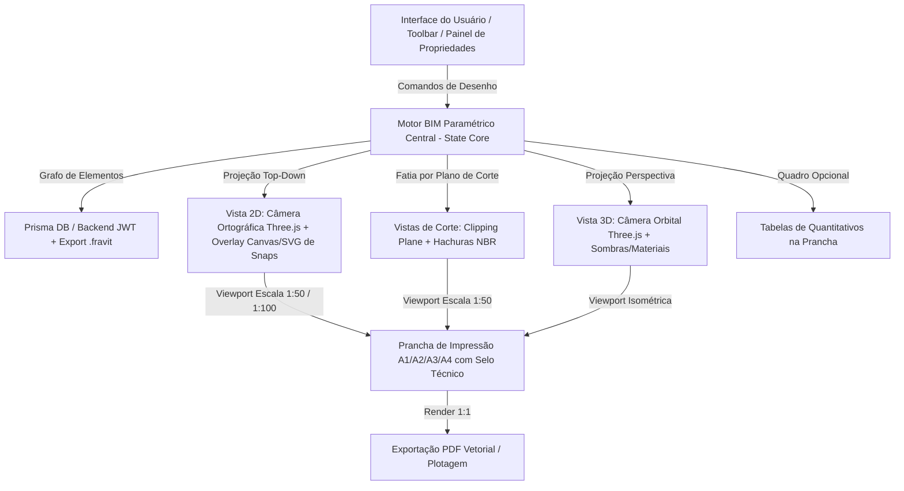
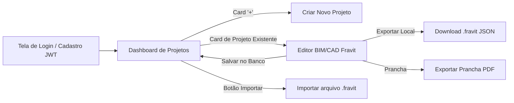

# Fravit — Planejamento e Especificação Arquitetural Completa

O **Fravit** é um software CAD/BIM moderno para desenho técnico arquitetônico e modelagem 3D paramétrica, executado no navegador com suporte a empacotamento desktop (Tauri/Electron), persistência em backend próprio e exportação em padrões técnicos normativos (NBR / PDF vetorial / DXF).

---

## 1. Visão Geral da Arquitetura

O sistema adota o paradigma **Single Source of Truth** (Modelo BIM Central Unificado):



---

## 2. Pilha Tecnológica (Tech Stack)

### Frontend (Client-side CAD/BIM)
- **Framework Core**: React 18+ com TypeScript e Vite.
- **Renderização Gráfica 2D e 3D**:
  - **Three.js**: Câmera Ortográfica para planta técnica 2D (com shaders de linhas finas/grossas e hachuras) e Câmera Perspectiva/Orbital para navegação 3D.
  - **Clipping Planes paramétricos**: Para fatiamento em tempo real nos cortes (Sections) e profundidade de visão (*Far Clip Plane*).
  - **Canvas 2D / SVG Overlay**: Para renderização de alta fidelidade de guias de alinhamento, snaps magnéticos, dimensões dinâmicas e arcos de abertura de portas.
- **Gerenciamento de Estado**: Zustand com histórico Undo/Redo (Command Pattern).
- **Estilização**: Tailwind CSS / CSS Modules com visual moderno escuro (dark mode com alto contraste para desenho técnico).
- **Exportação de Pranchas**: `jspdf` / `svg2pdf` para geração de PDF vetorial em escala exata (1:50, 1:100, etc.).

### Backend (Persistência & Contas)
- **Runtime**: Node.js com TypeScript e Express.
- **ORM & Banco de Dados**: Prisma ORM com SQLite (desenvolvimento local ágil e portabilidade) ou PostgreSQL (produção).
- **Autenticação**: JWT (JSON Web Tokens) com senhas criptografadas via bcrypt.
- **Endpoints**:
  - `/api/auth/register`, `/api/auth/login`, `/api/auth/me`
  - `/api/projects`: Listagem (para o grid do dashboard), criação, leitura, atualização e exclusão (CRUD).
  - `/api/projects/:id/thumbnail`: Armazenamento de imagem miniatura gerada automaticamente pelo canvas.

---

## 3. Elementos Arquitetônicos e Parametrização

Todos os elementos são baseados em **Famílias e Tipos**, permitindo selecionar padrões de mercado ou **"Duplicar Tipo"** para criar variações sob medida.

| Elemento | Parâmetros Editáveis | Representação 2D (Planta Baixa) | Representação 3D |
| :--- | :--- | :--- | :--- |
| **Paredes** | Espessura (ex: 0.15m), Altura (desvinculada ou até Nível superior), Alinhamento (eixo, face externa/interna), Material/Hachura | Linhas de corte grossas com hachura interna; junção automática em canto (miter join) | Extrusão 3D contínua com perfurações automáticas nos vãos de portas e janelas |
| **Portas** | Largura (0.70m, 0.80m, etc.), Altura (2.10m), Sentido de abertura, Reversão (Espaço ou clique) | Folha da porta + arco de abertura a 90° em linha de projeção fina | Vão booleano na parede hospedeira + marco + folha 3D |
| **Janelas** | Largura (1.20m, 1.50m), Altura (1.00m, 1.20m), Altura do Peitoril (ex: 1.10m), Número de folhas | Linhas de batente e vidros duplos conforme NBR 6492 | Vão na parede + caixilho 3D + vidro translúcido |
| **Pisos / Lajes** | Polígono de contorno, Espessura da laje (0.10m), Desnível de elevação (offset), Material de acabamento | Linha de perímetro do piso e hachura opcional de paginação de piso | Placa sólida horizontal 3D com rebaixos |
| **Telhados** | Polígono do perímetro, Beiral / Overhang (0.60m), Inclinação (% ou graus), Número de águas (1, 2, 4 águas ou plano) | Linhas de cumeeira, espigão, rincão e setas indicativas de caimento | Cobertura volumétrica com inclinação calculada e empenas |
| **Escadas** | Largura do lance, Altura a vencer (nível base ao superior), Cálculo Blondel (2E+P=63cm), Riser/Tread, Corrimão | Linha de corte diagonal com ziguezague no térreo, numeração de degraus e seta de subida | Lances em degraus 3D, patamares e guarda-corpo |
| **Ambientes** | Nome do cômodo, Área calculada em m², Perímetro | Tag central com Nome + Área (ex: "SALA - 18.45 m²"), com detecção por paredes ou linhas separadoras | Volume do cômodo delimitado |
| **Separador de Ambiente** | Linha virtual 2D | Linha traço-ponto que divide cômodos contínuos (ex: Sala de Estar e Jantar) | Não visível no 3D |

---

## 4. Funcionalidades de Desenho Técnico (Precisão e Normas)

### 4.1. Sistema de Snaps e Precisão (Object Snap)
- **Snaps Magnéticos**: Extremidade (Endpoint), Ponto Médio (Midpoint), Interseção, Perpendicular e Centro.
- **Modos de Desenho**:
  - **Ortho (Shift)**: Trava o cursor em 0°, 90°, 180° e 270°.
  - **Polar Tracking**: Guias angulares suaves a cada 45° ou 30°.
  - **Entrada Numérica Dinâmica**: Durante o desenho de qualquer parede ou cota, o usuário pode digitar diretamente a medida no teclado (ex: `4.50` + `Enter`).

### 4.2. Cotas e Níveis Paramétricos
- **Cotas Lineares e Alinhadas**: Detectam faces de paredes e vértices; se a parede for movida, a cota atualiza seu valor automaticamente.
- **Cotas de Nível**:
  - Em planta: Símbolo circular NBR (ex: `N.P.O. +0.00` ou `N.P.S. +2.80`).
  - Em corte: Marcador de nível com linha de chamada horizontal.

### 4.3. Espessuras de Linha e Padrões Normativos (NBR 6492)
- **Linhas de Corte**: Traçado mais espesso (0.40mm - 0.60mm) para paredes e lajes seccionadas.
- **Linhas de Projeção**: Traçado médio (0.20mm - 0.30mm) para peitoris, louças e portas abertas.
- **Linhas Tracejadas**: Traçado fino (0.15mm) para projeções superiores (beirais, vãos acima do plano de corte de 1.50m).

---

## 5. Navegação, Andares, Cortes e Pranchas

### 5.1. Sistema de Andares (Níveis / Pavimentos)
- Gerenciador de Níveis na barra lateral:
  - Térreo (Elevação 0.00m)
  - 1º Pavimento (Elevação +2.80m)
  - Cobertura (Elevação +5.60m)
- Alternar entre andares exibe a planta baixa correspondente àquele nível com plano de corte horizontal padrão a 1.50m de altura.

### 5.2. Ferramenta de Cortes (Sections)
1. O usuário clica na ferramenta **Corte** na barra de ferramentas.
2. Clica no Ponto A e Ponto B na planta baixa.
3. É gerada a linha de corte com identificador (ex: "Corte A-A"), setas de sentido de visualização e uma caixa de profundidade (*Far Clip Plane*).
4. Automaticamente surge uma nova aba **[Corte A-A]** e um item correspondente no Navegador de Projeto.
5. Na aba do corte:
   - A geometria 3D é fatiada no plano exato.
   - Paredes e lajes cortadas exibem linha grossa e hachura técnica.
   - Elementos atrás do plano de corte são desenhados em projeção.
   - Linhas horizontais de nível indicam as alturas dos pavimentos.

### 5.3. Prancha de Impressão (Folha Principal) e Viewports
- Formatos de folha padronizados: **A1** (841x594mm), **A2** (594x420mm), **A3** (420x297mm) e **A4** (297x210mm).
- **Carimbo / Selo Técnico**: Margens normatizadas com campos editáveis (Nome do Projeto, Autor, Data, Prancha nº, etc.).
- **Arrastar e Soltar (Drag & Drop)**:
  - O usuário abre a aba **[Prancha 01]**.
  - Arrasta do Navegador de Projeto a **Planta do Térreo**, o **Corte A-A** ou a **Vista 3D**.
  - Ao soltar na folha, é instanciada uma **Viewport**.
  - A Viewport permite:
    - Escolher a escala gráfica: **1:50**, **1:100**, **1:200**, **1:25**.
    - Reposicionar livremente pela folha.
    - Exibir rótulo inferior automático: `01 - PLANTA BAIXA TÉRREO - ESCALA 1:50`.
- **Tabela de Quantitativos Opcional**:
  - Pode ser ativada e inserida na prancha como bloco lateral (Resumo de Portas, Janelas e Área dos Ambientes). Totalmente opcional.
- **Exportação**: Botão para gerar **PDF Vetorial em Escala Real** pronto para plotagem gráfica.

---

## 6. Fluxo de Usuário e Dashboard



### Dashboard Inicial:
- **Primeiro Bloco do Grid**: Botão com ícone `+` ("Novo Projeto") com escolha de nome e template inicial (ex: Planta em Branco ou Sobrado 2 Pavimentos).
- **Demais Blocos do Grid**: Cards dos projetos existentes salvos no banco de dados do usuário:
  - Thumbnail de pré-visualização automática do projeto.
  - Título do projeto e data da última modificação.
  - Menu de ações (Abrir, Duplicar, Renomear, Baixar `.fravit`, Excluir).

---

## 7. Estrutura de Diretórios do Projeto

```
Fravit/
├── PLANEJAMENTO.md             # Este documento
├── client/                     # Frontend React + TypeScript + Vite
│   ├── src/
│   │   ├── cad-core/           # Motor CAD/BIM
│   │   │   ├── elements/       # Definições (Wall, Door, Window, Floor, Roof, Stair, Room)
│   │   │   ├── engine/         # State central, histórico undo/redo, projeções
│   │   │   ├── geometry/       # CSG, booleans, cálculo de interseções e áreas m²
│   │   │   ├── renderer/       # Shaders Three.js, Câmeras (Ortho/Perspective), Clipping
│   │   │   └── snaps/          # Detecção de snaps (End, Mid, Ortho, Polar)
│   │   ├── components/
│   │   │   ├── canvas/         # Viewport 2D/3D e overlay de desenho
│   │   │   ├── dashboard/      # Grid de projetos, card '+', listagem de projetos
│   │   │   ├── layout/         # Navegador de projeto lateral, abas de vistas, toolbar
│   │   │   ├── properties/     # Painel de propriedades paramétricas e tipos
│   │   │   └── sheets/         # Prancha técnica, viewports arrastáveis, carimbo
│   │   ├── services/           # Chamadas à API (auth, projetos) e exportação PDF/.fravit
│   │   └── types/              # Interfaces TypeScript do modelo BIM
├── server/                     # Backend Node.js + Express + Prisma
│   ├── prisma/
│   │   └── schema.prisma       # Modelos User e Project (com JSON data e thumbnail)
│   ├── src/
│   │   ├── controllers/        # AuthController, ProjectController
│   │   ├── middleware/         # Autenticação JWT
│   │   └── routes/             # Rotas REST da API
└── package.json
```

---

## 8. Passo a Passo da Criação do Software (Guia de Execução)

Abaixo está o roteiro técnico detalhado para implementar o Fravit etapa por etapa.

### FASE 1: Fundação do Monorepo, Backend e Dashboard de Projetos

#### 1.1. Inicialização do Workspace
1. Criar `package.json` raiz com workspaces (`client` e `server`).
2. Configurar scripts de inicialização simultânea (`npm run dev` rodando client e server).

#### 1.2. Construção do Backend (Node.js + Express + Prisma + JWT)
1. Inicializar diretório `server/` com TypeScript e Express.
2. Instalar dependências: `express`, `cors`, `dotenv`, `bcryptjs`, `jsonwebtoken`, `prisma`, `@prisma/client`.
3. Criar `server/prisma/schema.prisma` com os modelos:
   - `User` (id, name, email, passwordHash, createdAt, updatedAt).
   - `Project` (id, title, description, bimData JSON, thumbnailBase64, userId, createdAt, updatedAt).
4. Executar migration inicial com SQLite (`npx prisma migrate dev --name init`).
5. Implementar rotas de autenticação (`/api/auth/register`, `/api/auth/login`, `/api/auth/me`).
6. Implementar rotas de projetos com middleware JWT (`/api/projects` GET, POST, PUT, DELETE).

#### 1.3. Construção do Frontend Base e Dashboard
1. Inicializar `client/` com Vite (`npm create vite@latest client -- --template react-ts`).
2. Configurar Tailwind CSS ou design system escuro profissional.
3. Criar contexto de autenticação (`AuthContext`) com telas de Login e Registro.
4. Construir o **Dashboard de Projetos**:
   - Layout com cabeçalho de usuário e barra de pesquisa.
   - Grid responsivo onde o **1º card é o bloco `+`** com modal para criar novo projeto.
   - Cards dos projetos com imagem de miniatura, data, título e menu de opções (abrir, baixar `.fravit`, excluir).
   - Botão para **Importar arquivo `.fravit`**.

---

### FASE 2: Engine Gráfica, Canvas 2D/3D e Sistema de Precisão (Snaps)

#### 2.1. Viewport Three.js e Câmeras
1. Instalar `three`, `@types/three` e Lucide Icons no frontend.
2. Criar componente `CADViewport.tsx`:
   - Configurar `WebGLRenderer` com antialiasing e suporte a clipping planes.
   - Implementar Câmera Ortográfica top-down para o modo 2D (Pan com botão do meio/direito do mouse e Zoom com scroll da rodinha).
   - Implementar Câmera Perspectiva com OrbitControls para a visualização 3D.
   - Alternância fluida entre vista 2D e 3D.
3. Implementar Grid Infinito com divisões maiores (1.0m) e menores (0.10m).

#### 2.2. Sistema de Snaps e Precisão no Canvas Overlay
1. Criar componente `CanvasOverlay.tsx` posicionado sobre o canvas Three.js para renderização de feedback 2D imediato.
2. Implementar detecção de snaps:
   - `Grid Snap` (arredondamento para múltiplos configuráveis, ex: 0.05m).
   - `Endpoint Snap` (extremidades de paredes existentes com indicador quadrado verde).
   - `Midpoint Snap` (pontos médios com indicador triângulo verde).
   - `Intersection Snap` (cruzamentos de eixos).
   - `Ortho Mode` (tecla Shift ou trava F8 para ângulos retos 0°, 90°, 180°, 270°).
   - `Polar Tracking` (guias pontilhadas nos ângulos 45°).
3. Caixa de Entrada Numérica Dinâmica (digitar a medida desejada e pressionar `Enter`).

#### 2.3. Estado Central do Modelo BIM (Zustand Core)
1. Estruturar o estado no `bimStore.ts`:
   - Lista de `levels` (andares/pavimentos com suas elevações).
   - Dicionário de `elements` (paredes, portas, janelas, pisos, telhados, escadas, cômodos).
   - Pilha de histórico para `undo` / `redo` (Ctrl+Z / Ctrl+Y).
   - Nível ativo e ferramenta ativa.

---

### FASE 3: Modelagem dos Elementos Arquitetônicos Paramétricos

#### 3.1. Paredes (Walls)
1. Ferramenta interativa de parede (clique inicial e final, com preview contínuo).
2. Algoritmo de junção automática de cantos (miter joint em 2D e geometria contínua 3D).
3. Parâmetros: Espessura (ex: 0.15m), Altura (desvinculada ou atrelada ao próximo nível), Material.
4. Renderização técnica em 2D: Linhas externas em traço grosso e hachura interna sólida ou diagonal.
5. Renderização 3D: Malha tridimensional gerada proceduralmente.

#### 3.2. Portas e Janelas (Vãos e Aberturas Paramétricas)
1. Inserção ancorada na parede hospedeira (*Wall-hosted elements*).
2. O cursor detecta a parede mais próxima ao passar por cima; clicar fixa o vão.
3. Abertura do vão na parede (perfuração booleana automática em 2D e 3D).
4. Representação 2D:
   - Portas: Batentes + folha + arco de abertura a 90° em linha fina. Tecla `Espaço` inverte o lado de abertura.
   - Janelas: Marco duplo e linhas de vidro conforme convenção técnica NBR.
5. Sistema de Famílias/Tipos: Presets prontos (P60, P70, P80, P90, J100, J120) com botão **"Duplicar Tipo"** para criar variações livres de largura, altura e peitoril.

#### 3.3. Pisos (Floors)
1. Ferramenta de definição por polígono de vértices ou clique em paredes de contorno.
2. Parâmetros: Espessura da laje (ex: 0.10m), Desnível/Offset (ex: -0.05m em áreas molhadas).
3. Geração da laje sólida 3D no nível correspondente.

#### 3.4. Telhados (Roofs)
1. Ferramenta de perímetro de cobertura com beiral configurável (overhang).
2. Parâmetros: Inclinação (% ou graus), tipo (1 água, 2 águas, 4 águas ou laje plana).
3. Geração 3D com caimento e cumeeiras.

#### 3.5. Escadas (Stairs)
1. Desenho do lance de escada entre dois níveis.
2. Cálculo automático de degraus pela Fórmula de Blondel (`2 * Espelho + Piso = 63 a 64 cm`).
3. Representação 2D: Linha de quebra diagonal de corte com seta indicadora de subida e numeração de degraus.
4. Representação 3D: Degraus sólidos e guarda-corpo paramétrico.

#### 3.6. Ambientes e Separador de Ambiente
1. **Separador de Ambiente**: Ferramenta de linha virtual traço-ponto para delimitar cômodos integrados (ex: Cozinha e Sala).
2. **Ambiente (Room Tag)**:
   - Detecção do polígono fechado formado por paredes e linhas separadoras.
   - Cálculo automático da área em metros quadrados (`m²`) e perímetro.
   - Inserção de etiqueta técnica no centro do cômodo com Nome e Área editáveis.

---

### FASE 4: Andares, Cortes Paramétricos e Anotações Técnicas

#### 4.1. Gerenciador de Andares / Níveis
1. Criação e exclusão de níveis (Térreo, Pavimento Superior, Cobertura, etc.).
2. Atribuição de elevações (ex: Térreo: 0.00m, 1º Andar: 2.80m).
3. Barra de abas superiores para alternar instantaneamente a vista ativa entre os andares.

#### 4.2. Ferramenta de Cortes (Sections)
1. Ferramenta interativa de linha de corte (clique Ponto A e Ponto B).
2. Símbolo de corte normatizado com círculos nas pontas, setas de visualização e identificador ("A-A").
3. Caixa de profundidade ajustável (*Far Clip Plane*).
4. Ao concluir, gera automaticamente uma nova aba de visualização **[Corte A-A]**.
5. Na vista de corte:
   - Uso de `THREE.ClippingPlane` para fatiar o modelo 3D.
   - Renderização das partes cortadas com linhas grossas e hachuras.
   - Projeção de fundo com linhas finas.
   - Linhas horizontais indicadoras de nível com marcas de elevação.

#### 4.3. Cotas e Níveis Paramétricos
1. Ferramenta de Cota Alinhada / Linear: clique em dois pontos ou faces de parede.
2. Linhas de extensão, linha de cota e texto com a medida em metros (ex: `3.25`).
3. Cotas de nível em planta com símbolo normatizado (`N.P.O. +0.00`).

---

### FASE 5: Prancha de Impressão, Viewports e Exportação

#### 5.1. Folha de Prancha Paramétrica
1. Seleção de tamanhos de papel padrão: **A1, A2, A3, A4** (horizontal ou vertical).
2. Margens normatizadas e **Carimbo/Selo Técnico** personalizável com campos de projeto.

#### 5.2. Viewports com Drag & Drop e Escalas
1. No Navegador de Projeto lateral, o usuário clica e arrasta qualquer planta baixa, corte ou vista 3D para dentro da prancha.
2. A soltura cria uma **Viewport**:
   - Caixa de recorte ajustável (*Crop Region*).
   - Seletor de escala gráfica: **1:50, 1:100, 1:200, 1:25**.
   - Rótulo inferior com número do detalhe, título da vista e escala.
3. Possibilidade de organizar múltiplas viewports na mesma folha.

#### 5.3. Tabela de Quantitativos Opcional
1. Bloco de tabela opcional que pode ser arrastado para a prancha.
2. Quadro automático de esquadrias (código da porta/janela, dimensões L x A, peitoril e quantidade).
3. Quadro de áreas dos ambientes (nome do cômodo e m²).

#### 5.4. Exportação Vetorial e Formato .fravit
1. Exportação da prancha montada para **PDF Vetorial 1:1** pronto para impressão técnica.
2. Botão de download do arquivo de projeto completo em formato `.fravit` (JSON estruturado).
3. Salvamento automático local e sincronização com o backend próprio via JWT.
